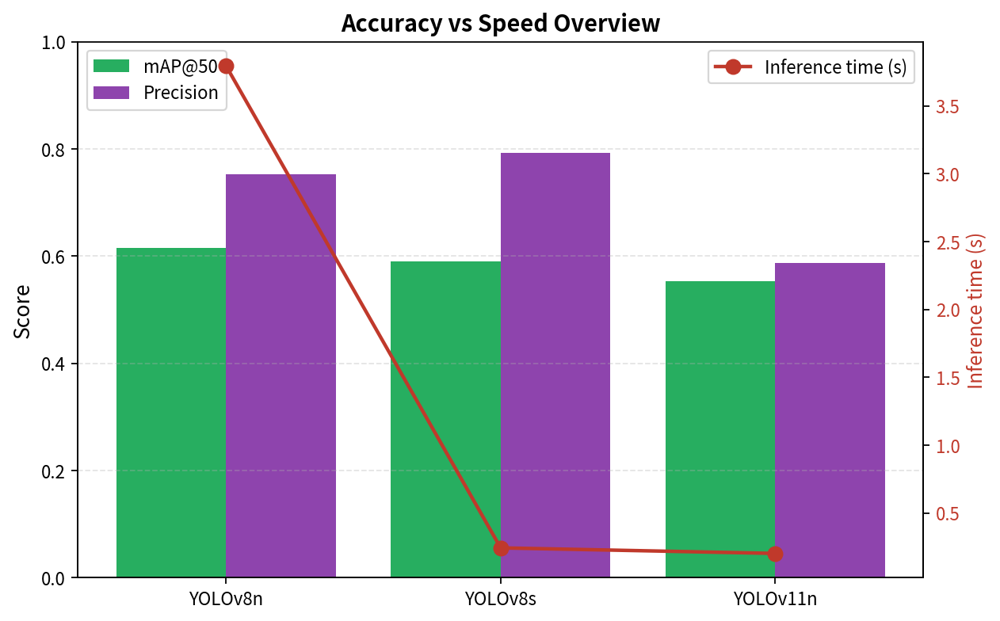
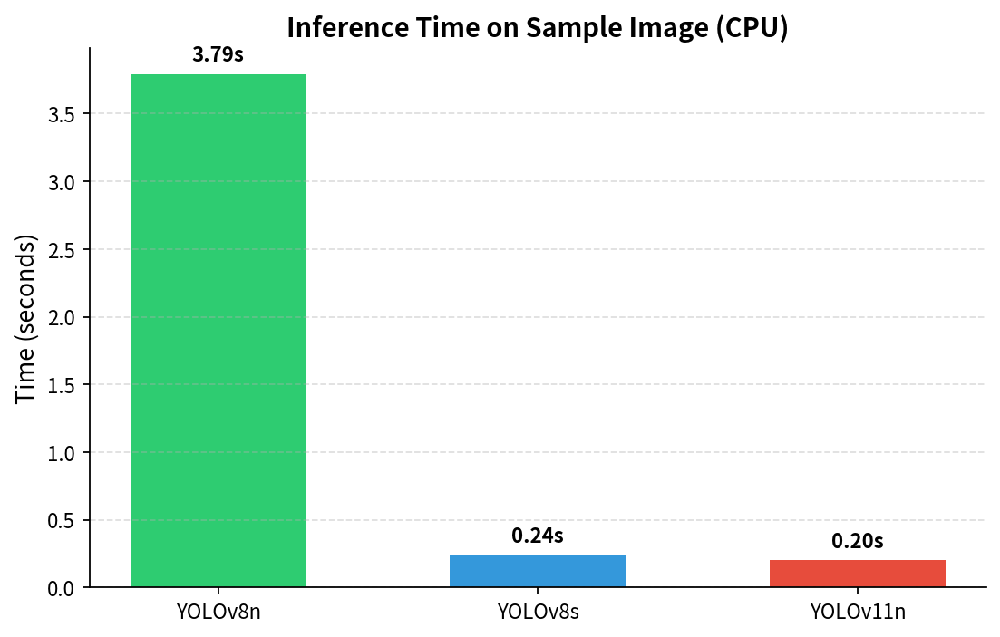

# Helmet Detection using YOLOv8 & YOLOv11

Welcome to the **Helmet Detection** repository.  
This project focuses on detecting whether people are wearing safety helmets in images, using modern object detection models. The system can identify multiple people in a single frame and classify each as `helmet` or `without_helmet`.

The work includes training, evaluation, and comparison of three YOLO models, along with ready-to-use inference scripts for local testing.


---

## Contents

```
Overview
    Problem definition
    Goals of the project

Models
    YOLOv8n
    YOLOv8s
    YOLOv11n

Dataset
    Source and classes
    Training setup

Results
    Quantitative comparison table
    Sample inference outputs

Project Structure
Getting Started
    Installation
    Training (Google Colab)
    Local inference

Future Improvements
Contributing
```

---

## Overview

Head injuries caused by not wearing a helmet remain a serious safety issue in construction sites, industrial areas, and traffic environments. Manual monitoring is expensive and error-prone. This project builds an automated computer vision pipeline that detects helmet usage on multiple people at the same time.

**Main goals:**
- Detect helmet / no-helmet on people's heads (motorcycle or pedestrian does not matter)
- Support multi-person detection in one image
- Compare different YOLO model sizes for accuracy and speed
- Provide clean, reproducible training and inference code


---

## Models

Three models were trained and compared under the same settings:

| Model | Description |
|-------|-------------|
| **YOLOv8n** | Lightweight baseline, good balance of speed and accuracy |
| **YOLOv8s** | Slightly larger, higher precision |
| **YOLOv11n** | Newer architecture generation |

Training configuration:
- Epochs: 60
- Image size: 640
- Batch size: 16
- Device: Google Colab GPU

---

## Dataset

A public Roboflow dataset with two classes was used:
- `helmet`
- `without_helmet`

The dataset is relatively small (~660 images), which makes training fast and suitable for educational experiments. Larger and more diverse data would further improve real-world performance.

---

## Results

### Quantitative metrics

| Model    | mAP@50 | mAP@50-95 | Precision | Recall |
|----------|--------|-----------|-----------|--------|
| **YOLOv8n**  | **0.616** | **0.202** | 0.752 | **0.541** |
| YOLOv8s  | 0.590  | 0.187     | **0.792** | 0.495  |
| YOLOv11n | 0.553  | 0.186     | 0.587 | 0.507  |





**Summary:**
- **YOLOv8n** achieved the best overall mAP and recall → recommended as the main model
- **YOLOv8s** obtained the highest precision (fewer false positives)
- **YOLOv11n** was the fastest at inference but less accurate on this dataset

### Sample local inference

| Model    | Inference time (CPU) | Detections on sample image      |
|----------|----------------------|---------------------------------|
| YOLOv8n  | 3.79 s               | helmet: 3                       |
| YOLOv8s  | 0.24 s               | helmet: 1                       |
| YOLOv11n | 0.20 s               | without_helmet: 2, helmet: 2    |

---

## Project Structure

```
helmet-detection-yolo/
├── README.md
├── requirements.txt
├── train_colab.py              # Train the three models
├── test_helmet_models.py       # Local comparison & visualization
└── helmet_models/              # Place trained weights here
    ├── yolov8n_best.pt
    ├── yolov8s_best.pt
    └── yolov11n_best.pt
```

---

## Getting Started

### 1. Clone the repository

```bash
git clone https://github.com/ma-bgh/helmet-detection-yolo.git
cd helmet-detection-yolo
```

### 2. Install dependencies

```bash
pip install -r requirements.txt
```

### 3. Training (recommended on Google Colab)

1. Upload your YOLO-format dataset (must contain `data.yaml`)
2. Open `train_colab.py`
3. Set the correct path to `data.yaml`
4. Run the script

Weights will be saved under `runs/detect/helmet_research/`.

### 4. Local inference and comparison

1. Put the three `best.pt` files inside `helmet_models/`
2. Set `IMAGE_PATH` in `test_helmet_models.py`
3. Run:

```bash
python test_helmet_models.py
```

Results (images + summary) are saved in `comparison_results/`.

---

## Future Improvements

- Train on a larger and more diverse helmet dataset
- Add real-time webcam / video streaming demo
- Export models to ONNX or TensorRT for faster deployment
- Extend to other PPE classes (vest, gloves, etc.)

---

## Contributing

Contributions are welcome. If you improve the models, add a new dataset, or build a better demo, feel free to fork the repository and open a pull request.

---

## License

This project is intended for educational and research purposes.
